# Отчёт: мультизадачная классификация

## Воспроизведение

- Seed зафиксирован до загрузки данных и инициализации модели: `42`
- Запрошено эпох: 5
- Завершено эпох: 5
- Лучшая эпоха по среднему val macro-F1: 5
- Средний val macro-F1 лучшей эпохи: 0.903
- Средний val accuracy лучшей эпохи: 0.930
- Возобновление: обучение с нуля

## Данные

Датасет `ashraq/fashion-product-images-small`. Задачи: `masterCategory`, `gender`, `season`, `usage`.
Строка остаётся в выборке, только если метка каждой задачи входит в её список классов.
На класс задачи `masterCategory` не больше 1500 примеров. Разбиение стратифицировано по этой задаче.
Размеры сплитов: train 4200, val 900, test 900.

### masterCategory

| Класс | Примеров в ограниченной выборке |
| --- | ---: |
| Accessories | 1500 |
| Apparel | 1500 |
| Footwear | 1500 |
| Personal Care | 1500 |

### gender

| Класс | Примеров в ограниченной выборке |
| --- | ---: |
| Boys | 70 |
| Girls | 60 |
| Men | 2717 |
| Unisex | 322 |
| Women | 2831 |

### season

| Класс | Примеров в ограниченной выборке |
| --- | ---: |
| Fall | 1088 |
| Spring | 1541 |
| Summer | 2221 |
| Winter | 1150 |

### usage

| Класс | Примеров в ограниченной выборке |
| --- | ---: |
| Casual | 4992 |
| Ethnic | 255 |
| Formal | 250 |
| Sports | 503 |

Исходные фотографии в датасете — миниатюры около 60 px. Перед энкодером они приводятся к 224 px, карта cross-attention имеет размер 7×7.

## Модель

Фото и текст объединяются общим двунаправленным cross-attention. У каждой задачи своя линейная голова на объединённом представлении. Функция потерь — сумма cross-entropy по задачам без весов. Строки «Только фото» и «Только текст» — отдельные головы этой же задачи, модальности они не смешивают.

## Графики

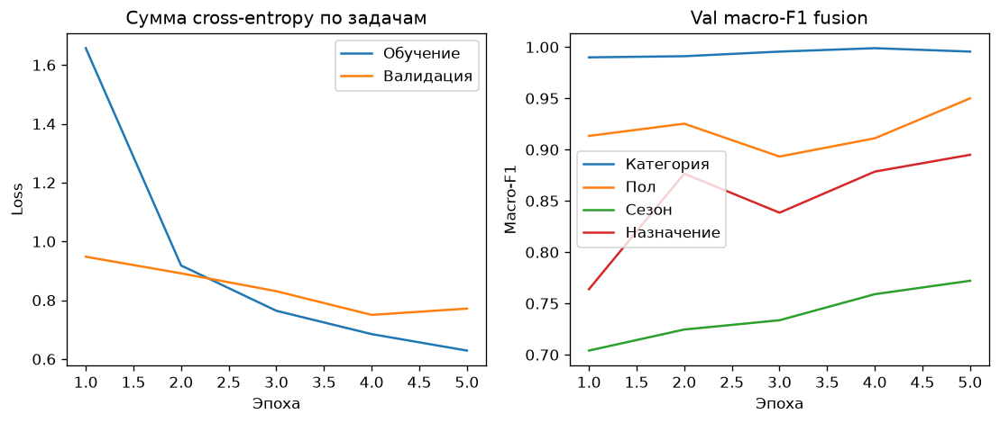

## masterCategory

| Модель | Accuracy | Macro-F1 |
| --- | ---: | ---: |
| Кросс-attention | 0.992 | 0.992 |
| Только фото | 0.980 | 0.980 |
| Только текст | 0.973 | 0.973 |

### masterCategory: Кросс-attention

| Класс | Precision | Recall | F1 | Support |
| --- | ---: | ---: | ---: | ---: |
| Accessories | 0.995 | 0.978 | 0.987 | 225 |
| Apparel | 0.987 | 0.996 | 0.991 | 225 |
| Footwear | 0.991 | 1.000 | 0.996 | 225 |
| Personal Care | 0.996 | 0.996 | 0.996 | 225 |

### masterCategory: Только фото

| Класс | Precision | Recall | F1 | Support |
| --- | ---: | ---: | ---: | ---: |
| Accessories | 0.960 | 0.964 | 0.962 | 225 |
| Apparel | 0.987 | 0.987 | 0.987 | 225 |
| Footwear | 0.987 | 1.000 | 0.993 | 225 |
| Personal Care | 0.986 | 0.969 | 0.978 | 225 |

### masterCategory: Только текст

| Класс | Precision | Recall | F1 | Support |
| --- | ---: | ---: | ---: | ---: |
| Accessories | 0.953 | 0.982 | 0.967 | 225 |
| Apparel | 0.995 | 0.924 | 0.959 | 225 |
| Footwear | 0.965 | 0.991 | 0.978 | 225 |
| Personal Care | 0.982 | 0.996 | 0.989 | 225 |

### Матрица ошибок кросс-attention: masterCategory

| Истинный \ предсказание | Accessories | Apparel | Footwear | Personal Care |
| --- | ---: | ---: | ---: | ---: |
| Accessories | 220 | 2 | 2 | 1 |
| Apparel | 1 | 224 | 0 | 0 |
| Footwear | 0 | 0 | 225 | 0 |
| Personal Care | 0 | 1 | 0 | 224 |

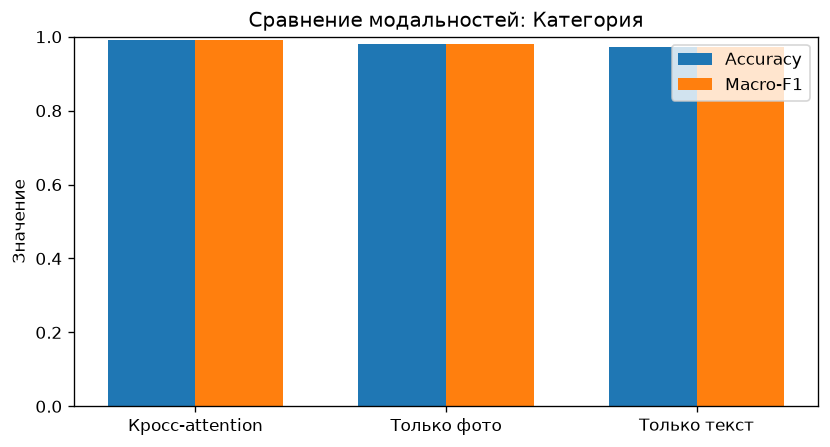

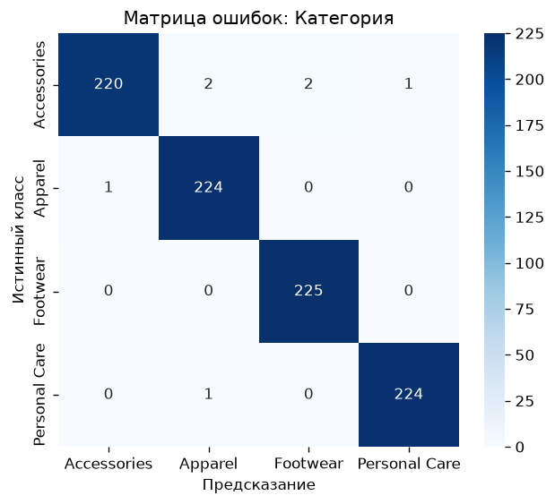

## gender

| Модель | Accuracy | Macro-F1 |
| --- | ---: | ---: |
| Кросс-attention | 0.990 | 0.842 |
| Только фото | 0.787 | 0.541 |
| Только текст | 0.991 | 0.875 |

### gender: Кросс-attention

| Класс | Precision | Recall | F1 | Support |
| --- | ---: | ---: | ---: | ---: |
| Boys | 0.250 | 1.000 | 0.400 | 1 |
| Girls | 0.833 | 0.833 | 0.833 | 6 |
| Men | 0.995 | 0.988 | 0.991 | 401 |
| Unisex | 1.000 | 0.979 | 0.989 | 48 |
| Women | 0.993 | 0.995 | 0.994 | 444 |

### gender: Только фото

| Класс | Precision | Recall | F1 | Support |
| --- | ---: | ---: | ---: | ---: |
| Boys | 0.000 | 0.000 | 0.000 | 1 |
| Girls | 1.000 | 0.500 | 0.667 | 6 |
| Men | 0.698 | 0.953 | 0.806 | 401 |
| Unisex | 0.682 | 0.312 | 0.429 | 48 |
| Women | 0.951 | 0.694 | 0.802 | 444 |

### gender: Только текст

| Класс | Precision | Recall | F1 | Support |
| --- | ---: | ---: | ---: | ---: |
| Boys | 0.250 | 1.000 | 0.400 | 1 |
| Girls | 1.000 | 1.000 | 1.000 | 6 |
| Men | 0.992 | 0.988 | 0.990 | 401 |
| Unisex | 1.000 | 0.979 | 0.989 | 48 |
| Women | 0.995 | 0.995 | 0.995 | 444 |

### Матрица ошибок кросс-attention: gender

| Истинный \ предсказание | Boys | Girls | Men | Unisex | Women |
| --- | ---: | ---: | ---: | ---: | ---: |
| Boys | 1 | 0 | 0 | 0 | 0 |
| Girls | 0 | 5 | 0 | 0 | 1 |
| Men | 3 | 0 | 396 | 0 | 2 |
| Unisex | 0 | 0 | 1 | 47 | 0 |
| Women | 0 | 1 | 1 | 0 | 442 |

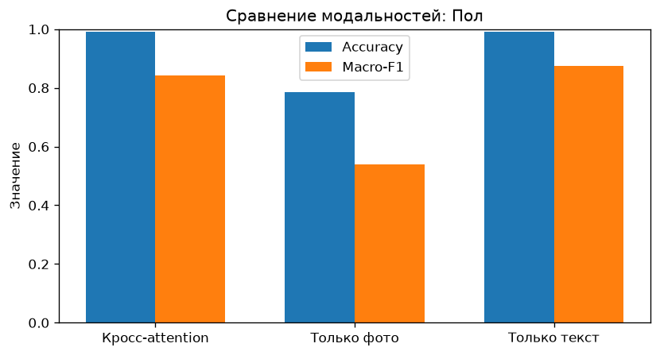

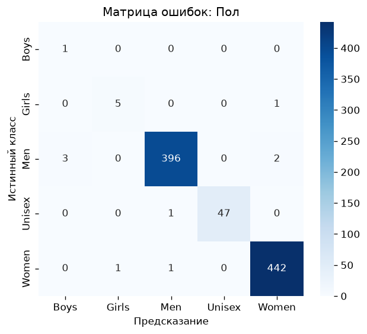

## season

| Модель | Accuracy | Macro-F1 |
| --- | ---: | ---: |
| Кросс-attention | 0.778 | 0.779 |
| Только фото | 0.680 | 0.647 |
| Только текст | 0.769 | 0.751 |

### season: Кросс-attention

| Класс | Precision | Recall | F1 | Support |
| --- | ---: | ---: | ---: | ---: |
| Fall | 0.567 | 0.654 | 0.607 | 162 |
| Spring | 0.977 | 0.935 | 0.956 | 230 |
| Summer | 0.688 | 0.743 | 0.715 | 315 |
| Winter | 0.948 | 0.751 | 0.838 | 193 |

### season: Только фото

| Класс | Precision | Recall | F1 | Support |
| --- | ---: | ---: | ---: | ---: |
| Fall | 0.455 | 0.247 | 0.320 | 162 |
| Spring | 0.967 | 0.878 | 0.920 | 230 |
| Summer | 0.549 | 0.813 | 0.656 | 315 |
| Winter | 0.832 | 0.591 | 0.691 | 193 |

### season: Только текст

| Класс | Precision | Recall | F1 | Support |
| --- | ---: | ---: | ---: | ---: |
| Fall | 0.644 | 0.414 | 0.504 | 162 |
| Spring | 0.968 | 0.909 | 0.937 | 230 |
| Summer | 0.656 | 0.810 | 0.724 | 315 |
| Winter | 0.843 | 0.834 | 0.839 | 193 |

### Матрица ошибок кросс-attention: season

| Истинный \ предсказание | Fall | Spring | Summer | Winter |
| --- | ---: | ---: | ---: | ---: |
| Fall | 106 | 0 | 55 | 1 |
| Spring | 3 | 215 | 11 | 1 |
| Summer | 70 | 5 | 234 | 6 |
| Winter | 8 | 0 | 40 | 145 |

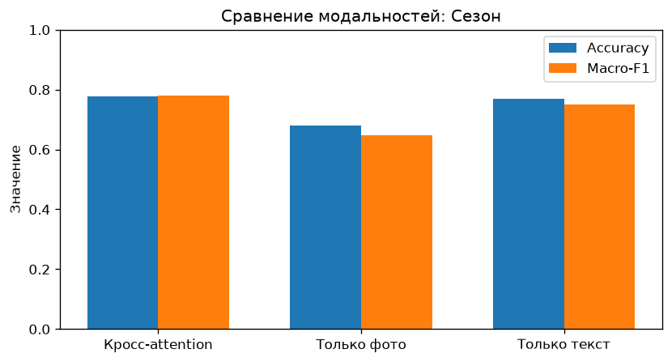

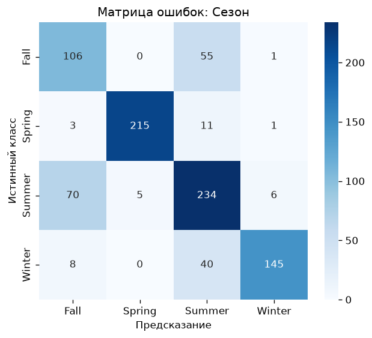

## usage

| Модель | Accuracy | Macro-F1 |
| --- | ---: | ---: |
| Кросс-attention | 0.946 | 0.870 |
| Только фото | 0.888 | 0.744 |
| Только текст | 0.940 | 0.865 |

### usage: Кросс-attention

| Класс | Precision | Recall | F1 | Support |
| --- | ---: | ---: | ---: | ---: |
| Casual | 0.957 | 0.979 | 0.968 | 749 |
| Ethnic | 0.925 | 0.974 | 0.949 | 38 |
| Formal | 0.920 | 0.676 | 0.780 | 34 |
| Sports | 0.841 | 0.734 | 0.784 | 79 |

### usage: Только фото

| Класс | Precision | Recall | F1 | Support |
| --- | ---: | ---: | ---: | ---: |
| Casual | 0.944 | 0.925 | 0.935 | 749 |
| Ethnic | 0.886 | 0.816 | 0.849 | 38 |
| Formal | 0.488 | 0.618 | 0.545 | 34 |
| Sports | 0.614 | 0.684 | 0.647 | 79 |

### usage: Только текст

| Класс | Precision | Recall | F1 | Support |
| --- | ---: | ---: | ---: | ---: |
| Casual | 0.962 | 0.968 | 0.965 | 749 |
| Ethnic | 1.000 | 0.921 | 0.959 | 38 |
| Formal | 0.885 | 0.676 | 0.767 | 34 |
| Sports | 0.741 | 0.797 | 0.768 | 79 |

### Матрица ошибок кросс-attention: usage

| Истинный \ предсказание | Casual | Ethnic | Formal | Sports |
| --- | ---: | ---: | ---: | ---: |
| Casual | 733 | 3 | 2 | 11 |
| Ethnic | 1 | 37 | 0 | 0 |
| Formal | 11 | 0 | 23 | 0 |
| Sports | 21 | 0 | 0 | 58 |

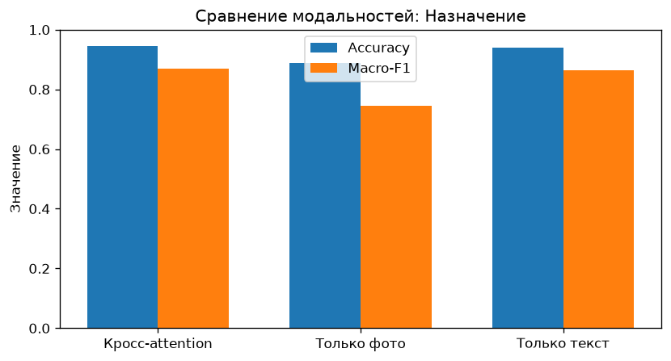

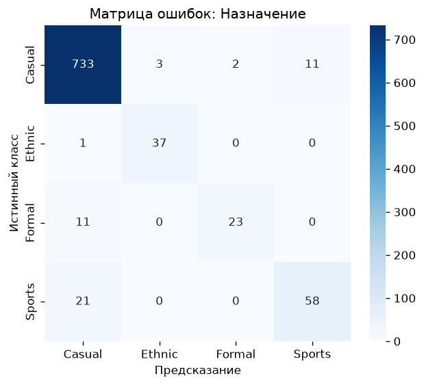

## Примеры

### Пример 1

- Текст: Puma Men Bolt Hawthorne Hex Black Shoes
- masterCategory: истина Footwear, предсказание Footwear. Вероятности: Accessories 0.000, Apparel 0.000, Footwear 1.000, Personal Care 0.000
- gender: истина Men, предсказание Men. Вероятности: Boys 0.000, Girls 0.000, Men 1.000, Unisex 0.000, Women 0.000
- season: истина Summer, предсказание Fall. Вероятности: Fall 0.525, Spring 0.003, Summer 0.455, Winter 0.018
- usage: истина Casual, предсказание Casual. Вероятности: Casual 0.751, Ethnic 0.001, Formal 0.028, Sports 0.220

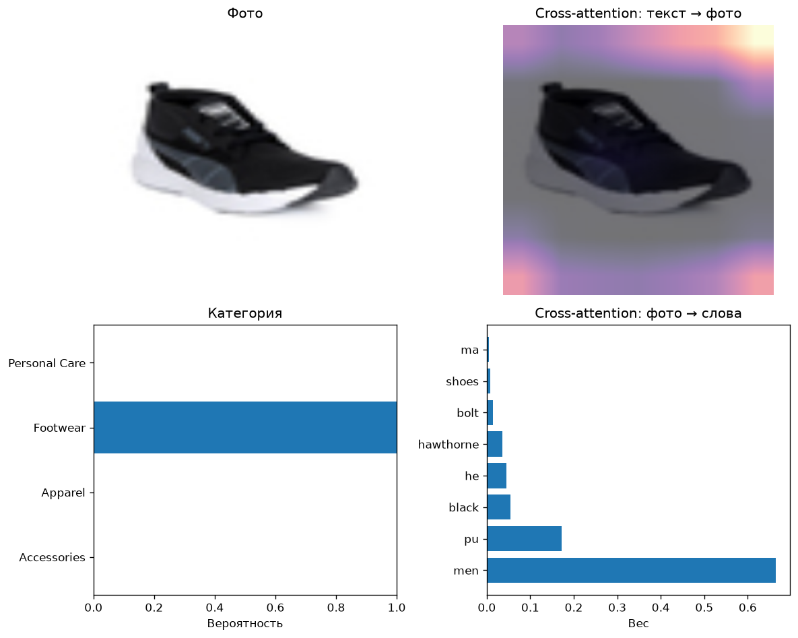

### Пример 2

- Текст: ADIDAS Men Black Dial Watch
- masterCategory: истина Accessories, предсказание Accessories. Вероятности: Accessories 0.999, Apparel 0.000, Footwear 0.001, Personal Care 0.000
- gender: истина Men, предсказание Men. Вероятности: Boys 0.001, Girls 0.000, Men 0.996, Unisex 0.002, Women 0.001
- season: истина Winter, предсказание Winter. Вероятности: Fall 0.000, Spring 0.000, Summer 0.008, Winter 0.991
- usage: истина Casual, предсказание Casual. Вероятности: Casual 0.978, Ethnic 0.000, Formal 0.001, Sports 0.022

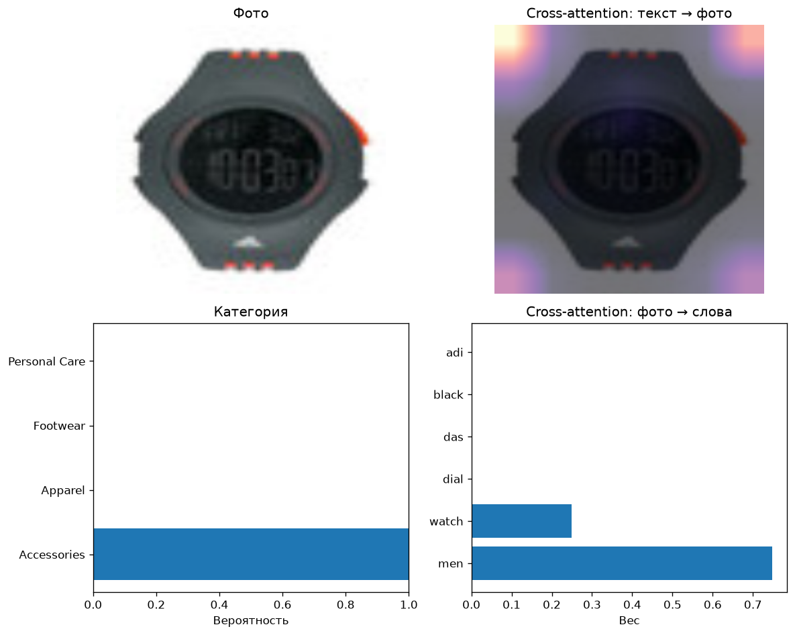

### Пример 3

- Текст: Scullers Women Solid Purple Tops
- masterCategory: истина Apparel, предсказание Apparel. Вероятности: Accessories 0.000, Apparel 0.998, Footwear 0.001, Personal Care 0.000
- gender: истина Women, предсказание Women. Вероятности: Boys 0.000, Girls 0.001, Men 0.001, Unisex 0.000, Women 0.999
- season: истина Fall, предсказание Fall. Вероятности: Fall 0.934, Spring 0.000, Summer 0.065, Winter 0.001
- usage: истина Casual, предсказание Casual. Вероятности: Casual 0.985, Ethnic 0.002, Formal 0.010, Sports 0.003

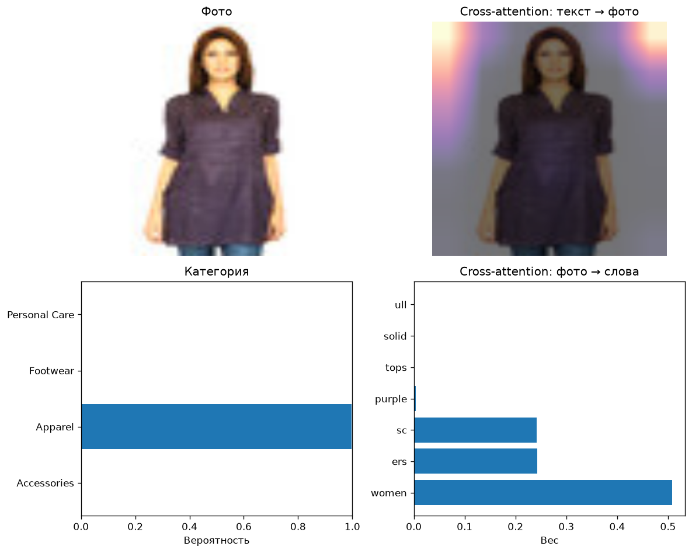

### Пример 4

- Текст: Colorbar Pro Love Her Madly Nail Lacquer 050
- masterCategory: истина Personal Care, предсказание Personal Care. Вероятности: Accessories 0.000, Apparel 0.000, Footwear 0.001, Personal Care 0.999
- gender: истина Women, предсказание Women. Вероятности: Boys 0.000, Girls 0.000, Men 0.000, Unisex 0.000, Women 1.000
- season: истина Spring, предсказание Spring. Вероятности: Fall 0.004, Spring 0.909, Summer 0.084, Winter 0.003
- usage: истина Casual, предсказание Casual. Вероятности: Casual 0.999, Ethnic 0.000, Formal 0.001, Sports 0.000

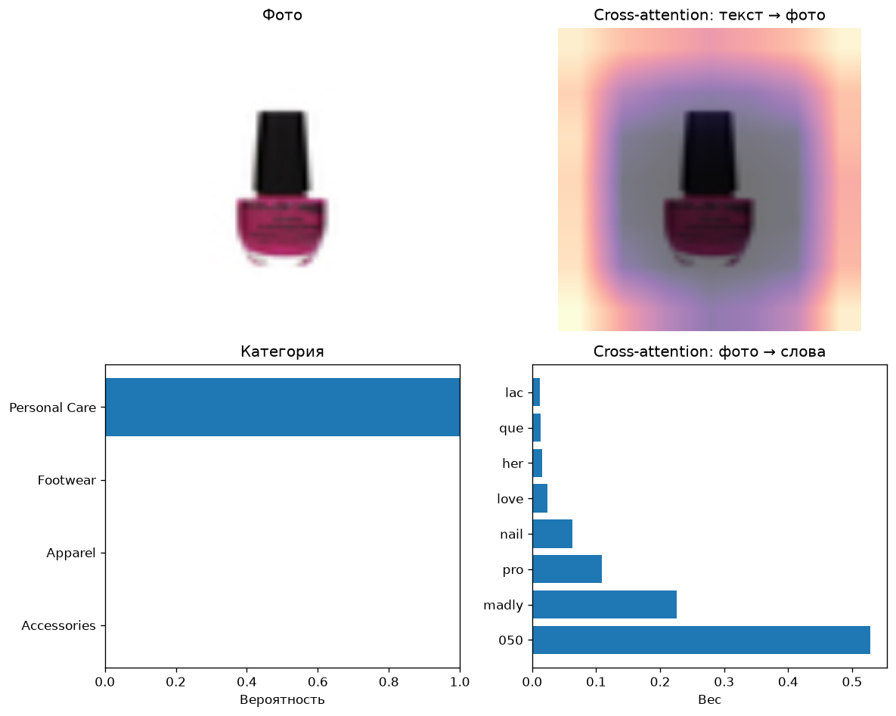

### Пример 5

- Текст: Wrangler Men's Racing Big Print Grey T-shirt
- masterCategory: истина Apparel, предсказание Apparel. Вероятности: Accessories 0.000, Apparel 1.000, Footwear 0.000, Personal Care 0.000
- gender: истина Men, предсказание Men. Вероятности: Boys 0.000, Girls 0.000, Men 1.000, Unisex 0.000, Women 0.000
- season: истина Summer, предсказание Summer. Вероятности: Fall 0.342, Spring 0.002, Summer 0.649, Winter 0.007
- usage: истина Casual, предсказание Casual. Вероятности: Casual 0.890, Ethnic 0.000, Formal 0.001, Sports 0.110

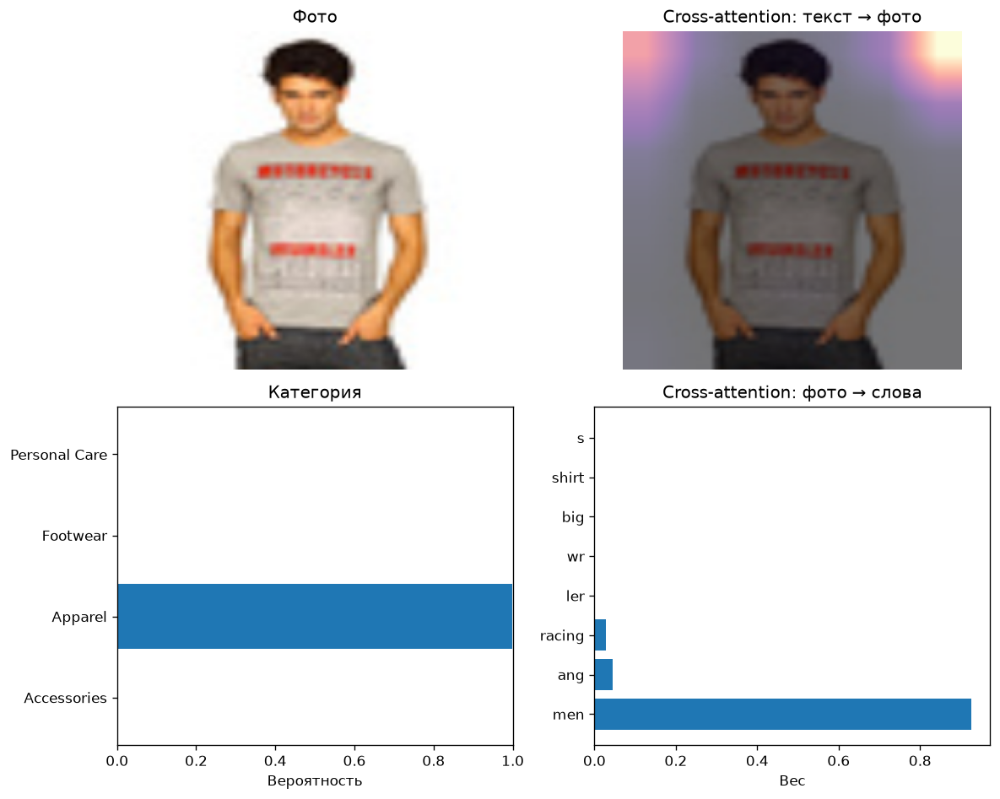

### Пример 6

- Текст: ADIDAS Originals Women F Night Logo TT White Jacket
- masterCategory: истина Apparel, предсказание Apparel. Вероятности: Accessories 0.001, Apparel 0.999, Footwear 0.001, Personal Care 0.000
- gender: истина Women, предсказание Women. Вероятности: Boys 0.000, Girls 0.000, Men 0.004, Unisex 0.000, Women 0.996
- season: истина Summer, предсказание Fall. Вероятности: Fall 0.892, Spring 0.000, Summer 0.107, Winter 0.001
- usage: истина Casual, предсказание Casual. Вероятности: Casual 0.534, Ethnic 0.089, Formal 0.041, Sports 0.336

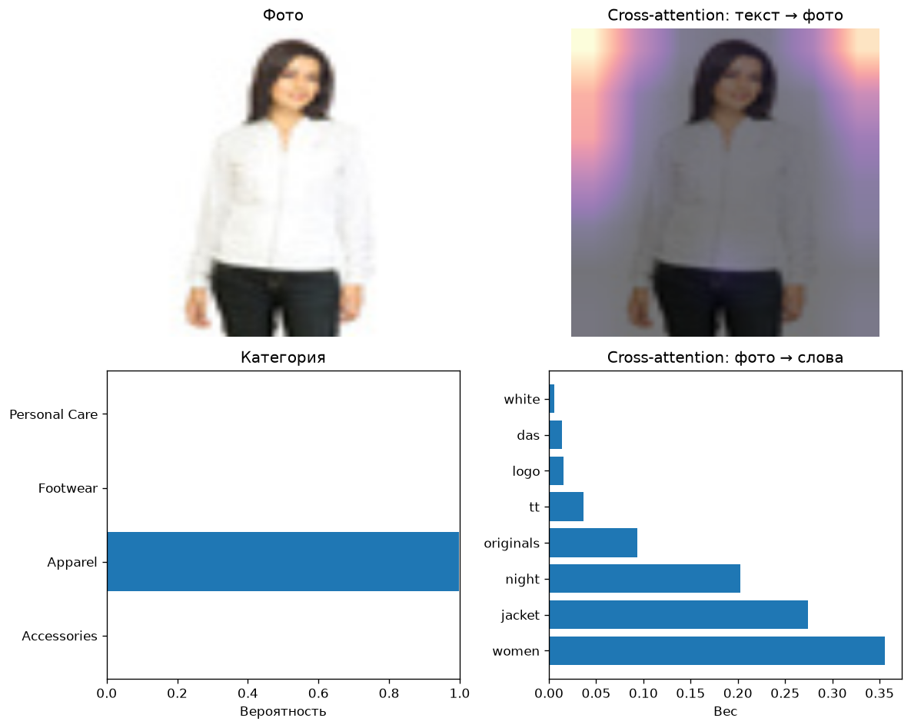

