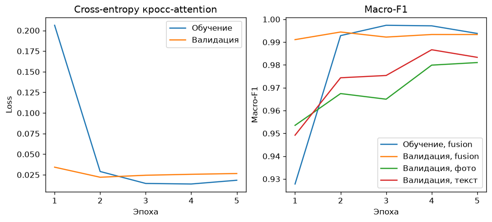
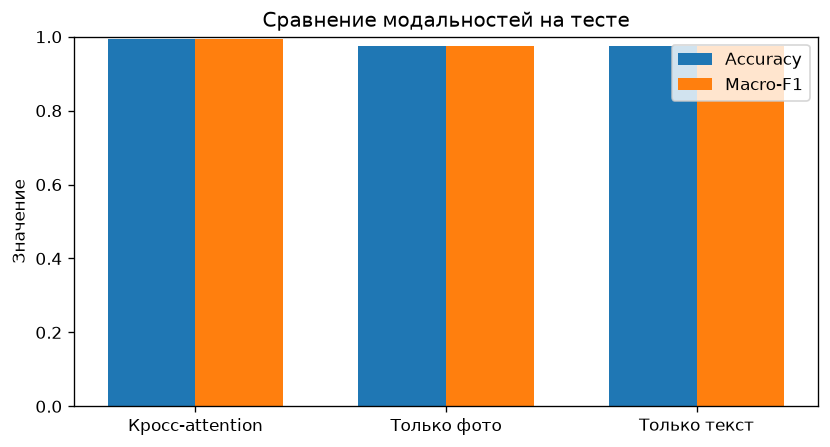
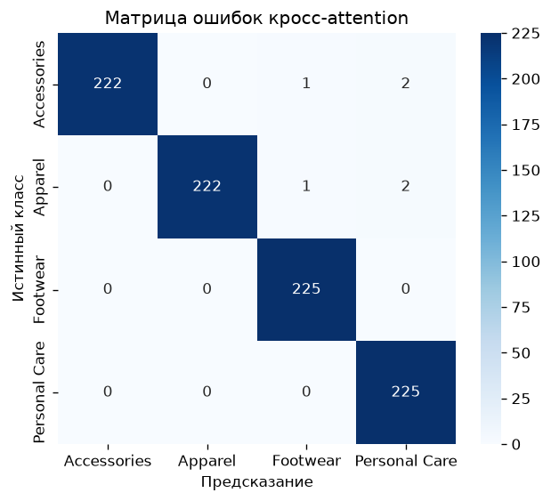
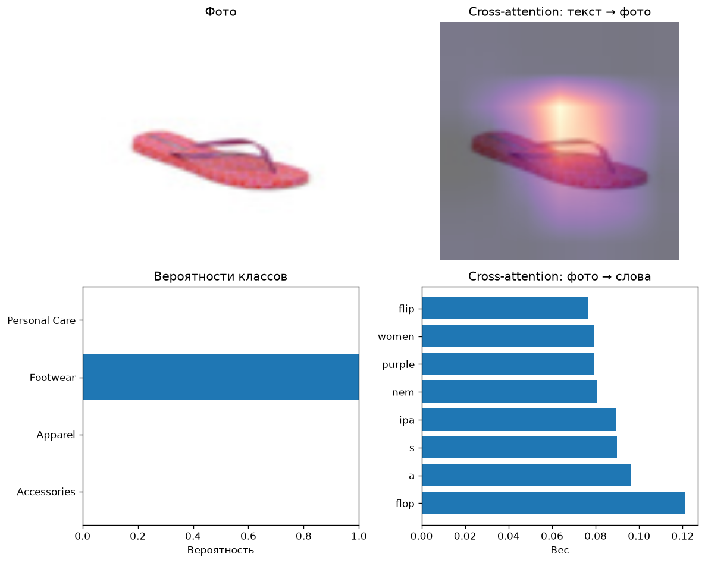
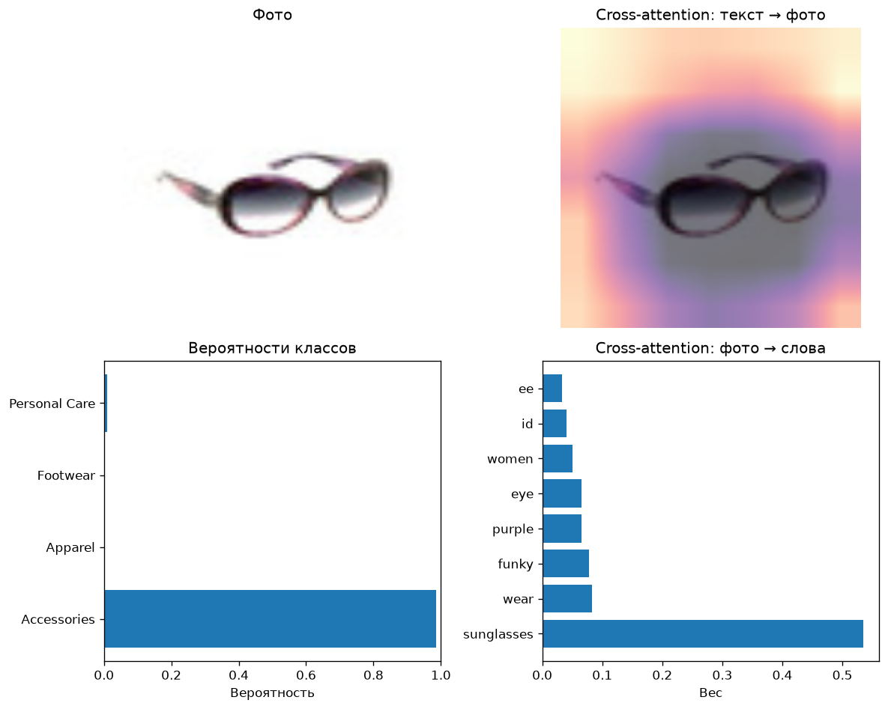
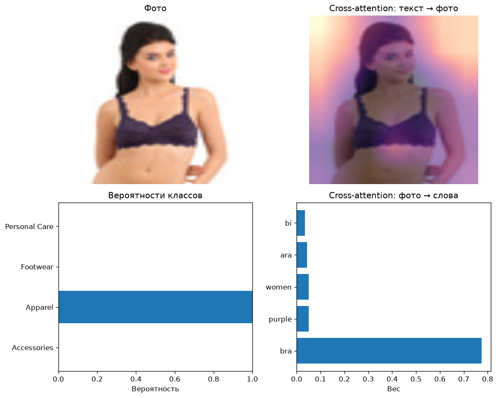
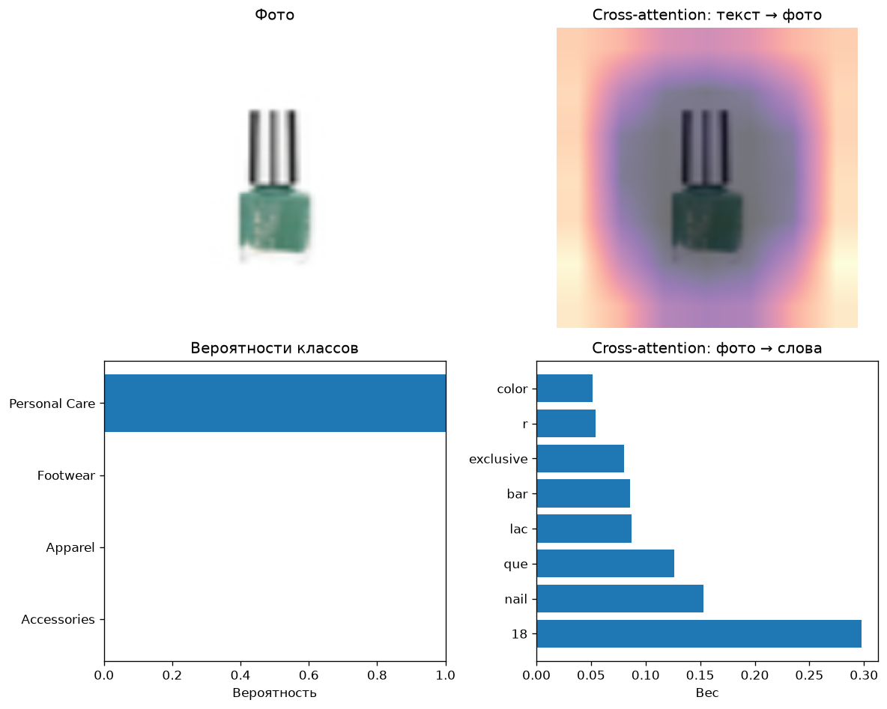
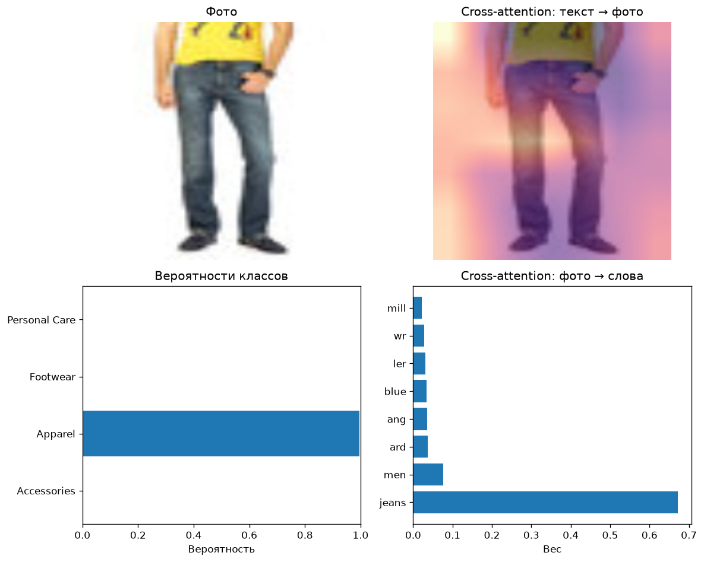
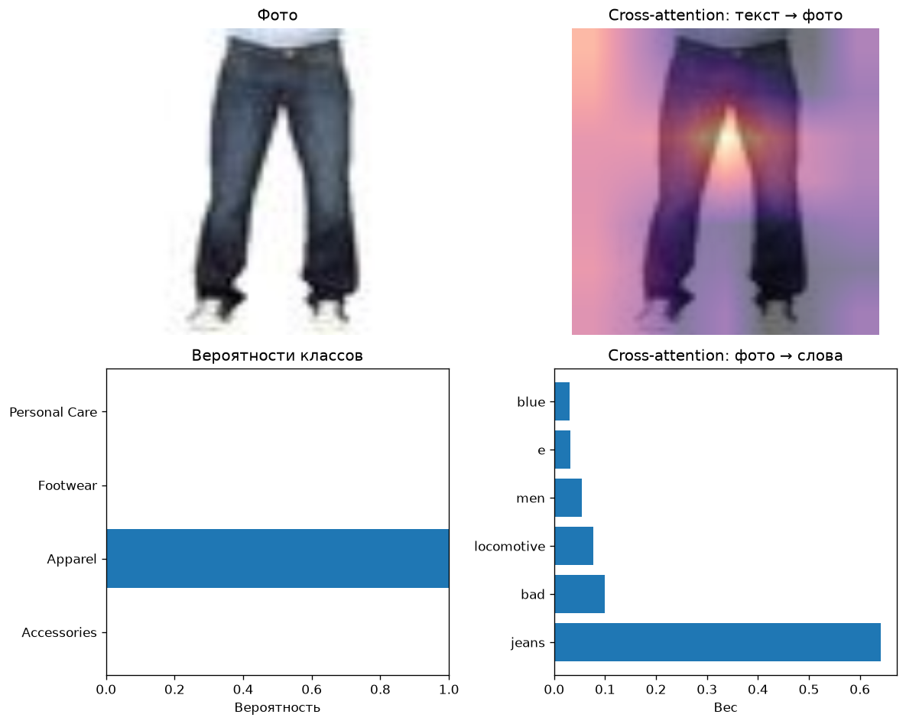

# Отчёт: мультимодальная классификация

## Воспроизведение

- Seed зафиксирован до загрузки данных и инициализации модели: `42`
- Запрошено эпох: 5
- Завершено эпох: 5
- Лучшая эпоха по val macro-F1: 2
- Val macro-F1 лучшей эпохи: 0.994
- Val accuracy лучшей эпохи: 0.994
- Возобновление: обучение с нуля

## Данные

Датасет `ashraq/fashion-product-images-small`. Цель — `masterCategory`.
На класс не больше 1500 примеров.
Размеры сплитов: train 4200, val 900, test 900.

| Класс | Примеров в ограниченной выборке |
| --- | ---: |
| Accessories | 1500 |
| Apparel | 1500 |
| Footwear | 1500 |
| Personal Care | 1500 |

Исходные фотографии в датасете — миниатюры около 60 px. Перед энкодером они приводятся к 224 px, карта cross-attention имеет размер 7×7.

## Модель

Фото и текст объединяются двунаправленным cross-attention.
Запросы изображения читают ключи и значения текста, запросы текста читают ключи и значения изображения.
В классификатор попадают уже обновлённые токены.
Строки «Только фото» и «Только текст» — отдельные головы без смешивания модальностей.

## Метрики на тесте

| Модель | Accuracy | Macro-F1 |
| --- | ---: | ---: |
| Кросс-attention | 0.993 | 0.993 |
| Только фото | 0.974 | 0.974 |
| Только текст | 0.976 | 0.976 |

### Кросс-attention

| Класс | Precision | Recall | F1 | Support |
| --- | ---: | ---: | ---: | ---: |
| Accessories | 1.000 | 0.987 | 0.993 | 225 |
| Apparel | 1.000 | 0.987 | 0.993 | 225 |
| Footwear | 0.991 | 1.000 | 0.996 | 225 |
| Personal Care | 0.983 | 1.000 | 0.991 | 225 |

### Только фото

| Класс | Precision | Recall | F1 | Support |
| --- | ---: | ---: | ---: | ---: |
| Accessories | 0.990 | 0.920 | 0.954 | 225 |
| Apparel | 0.987 | 0.982 | 0.984 | 225 |
| Footwear | 0.982 | 0.996 | 0.989 | 225 |
| Personal Care | 0.941 | 1.000 | 0.970 | 225 |

### Только текст

| Класс | Precision | Recall | F1 | Support |
| --- | ---: | ---: | ---: | ---: |
| Accessories | 0.969 | 0.960 | 0.964 | 225 |
| Apparel | 0.964 | 0.960 | 0.962 | 225 |
| Footwear | 0.978 | 0.982 | 0.980 | 225 |
| Personal Care | 0.991 | 1.000 | 0.996 | 225 |

### Матрица ошибок кросс-attention

| Истинный \ предсказание | Accessories | Apparel | Footwear | Personal Care |
| --- | ---: | ---: | ---: | ---: |
| Accessories | 222 | 0 | 1 | 2 |
| Apparel | 0 | 222 | 1 | 2 |
| Footwear | 0 | 0 | 225 | 0 |
| Personal Care | 0 | 0 | 0 | 225 |

## Графики

## Примеры

### Пример 1

- Текст: iPanema Women Purple Flip Flops
- Истинный класс: Footwear
- Предсказание: Footwear
- Вероятности: Accessories 0.000, Apparel 0.000, Footwear 1.000, Personal Care 0.000

### Пример 2

- Текст: Idee Women Funky Eyewear Purple Sunglasses
- Истинный класс: Accessories
- Предсказание: Accessories
- Вероятности: Accessories 0.986, Apparel 0.001, Footwear 0.003, Personal Care 0.011

### Пример 3

- Текст: Biara Women Purple Bra
- Истинный класс: Apparel
- Предсказание: Apparel
- Вероятности: Accessories 0.001, Apparel 0.999, Footwear 0.000, Personal Care 0.000

### Пример 4

- Текст: Colorbar Exclusive Nail Lacquer 18
- Истинный класс: Personal Care
- Предсказание: Personal Care
- Вероятности: Accessories 0.000, Apparel 0.000, Footwear 0.000, Personal Care 1.000

### Пример 5

- Текст: Wrangler Men Blue Millard Jeans
- Истинный класс: Apparel
- Предсказание: Apparel
- Вероятности: Accessories 0.004, Apparel 0.996, Footwear 0.000, Personal Care 0.000

### Пример 6

- Текст: Locomotive Men Bade Blue Jeans
- Истинный класс: Apparel
- Предсказание: Apparel
- Вероятности: Accessories 0.001, Apparel 0.999, Footwear 0.000, Personal Care 0.000

